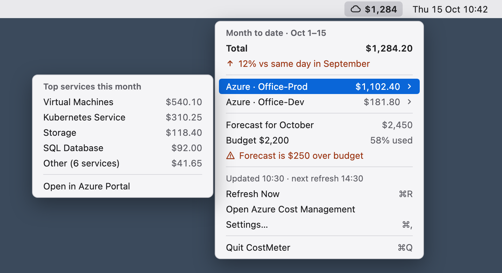

# CostMeter

A macOS menu bar app that shows month-to-date Azure spend for your subscriptions: a breakdown by
service, Azure's own forecast and your Azure Budgets. Each subscription can be tracked whole or
narrowed to one resource group, chosen from the menu.

It signs in through your existing `az login` session, stores no secrets, and only calls read-only
cost endpoints. Providers sit behind a cloud-neutral interface so AWS can be added later.

*Design mockup with sample numbers. The built menu also has **Scope**, **Settings** and
**About CostMeter** items, and no keyboard shortcuts.*

Status: built phase by phase from `thoughts/shared/plans/2026-10-15-costmeter.md`. The Azure
provider, the cache and scheduler, the menu bar UI with its scope picker and settings, and the
installable `.app` are in place; notifications come later.

## Install

`make install` builds the app, copies it to `~/Applications`, starts it and registers it to start
at login. See [docs/INSTALL.md](docs/INSTALL.md) for the prerequisites and troubleshooting.

## Settings

Everything is chosen in the menu; there is no config file.

| In the menu | What it does |
|---|---|
| **Scope › a subscription** | Track it whole or narrowed to one resource group (up to 10 subscriptions). **Track all subscriptions** undoes your choices. |
| **Settings › Refresh every** | 1, 2, 4 (the default), 8, 12 or 24 hours. |
| **Settings › Services listed** | 3, 4 or 5 (the default) services per row before "Other". |

The choices are saved in `~/Library/Application Support/costmeter/settings.json` (in
`costmeter-fake` with `--fake`). Deleting that file brings back the defaults.

## Make targets

| Target | What it does |
|---|---|
| `make build` | `go build ./...` |
| `make test` | `go test ./...` |
| `make vet` | `go vet ./...` |
| `make fmt-check` | fails if any file needs `gofmt` |
| `make run-fake` | runs the app with built-in sample data and separate state files |
| `make app` | builds `build/CostMeter.app` (with its icon, ad-hoc signed) |
| `make install` | builds, installs to `~/Applications` and starts it, also at every login (safe to repeat) |
| `make uninstall` | stops it and removes the app and its login agent (your settings and log are kept) |
| `make clean` | deletes `build/` |

`VERSION` and `BUILD` in the Makefile set the app's version numbers; raise `BUILD` for every
installable change.
